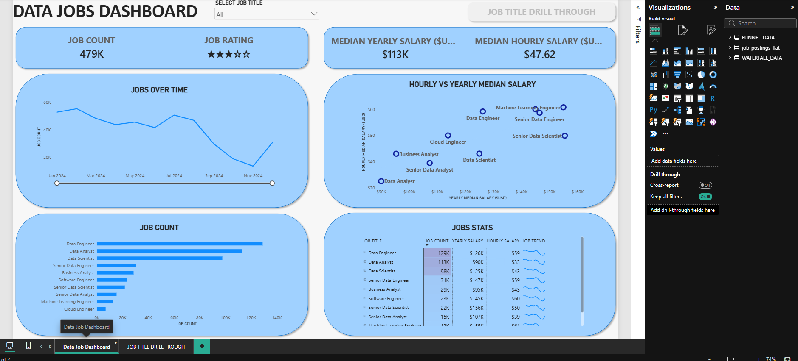
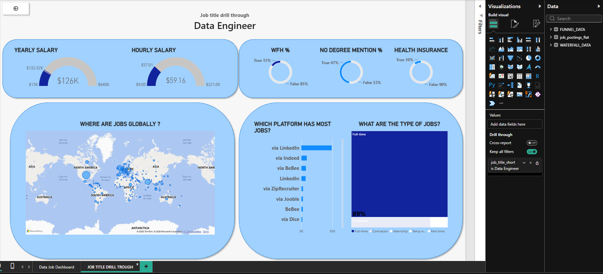

# DATA JOB DASHBOARD W/ POWER BI 

## INTRODUCTION

This Dashboard was created for **Job seekers , Job Transitioners , and Job Swappers** to solve a common problem: information about the data job market is scattered and hard to grasp . using a *real world dataset of 2024 data science job postings* (including titles , salaries and locations ), this project provides a single , easy-to-use interface to explore market trends and compensation

## SKILLS SHOWCASED

- **⚙️Data Transformation (ETL) with Power Query:**
Cleaned, shaped, and prepared raw data for analysis by handling blanks, changing data types, and creating new columns.
- **🧮Implicit Measures:** Created measures to derive insights and KPIs, including `Median Yearly Salary` and `Job Count`.
- **📊Core Charts:** Used column, bar, line, and area charts to compare job counts and track trends over time.
- **🗺️Geospatial Analysis:** Used map charts to visualize the global distribution of jobs.
- **🔢KPI Indicators and Tables:** Used cards to display key metrics and tables to provide granular, sortable data.
- **🎨Dashboard Design:** Designed an intuitive, visually appealing layout, choosing chart types to tell the data story.
- **🖱️Interactive Reporting:**
    - **Slicers:** Let users filter the report by job title.
    - **Buttons and Bookmarks:** Made it easier to navigate the report.
    - **Drill-through:** Let users move from a high-level summary to a contextual, detailed view.

## DASHBOARD OVERVIEW

### Page1 : High-Level Market View

This is your mission control for the data job market. It Showcases key KPIs
like total job count, Median salaries, and top job titles to give you a quick understanding of What's happening in the Job market at a glance.

### Page2 : Job Title Drill Through

This is the deep-dive page. From the main dashboard, you can drill through to this view to get specific details for a single job title, including salary ranges, work-from-home stats, top hiring platforms and a global map of job locations.

## CONCLUSION

This dashboard shows how Power BI can transform raw job posting data into a powerfool tool for career analysis. It allows users to slice, filter and drill through data to make informed design about there career paths.